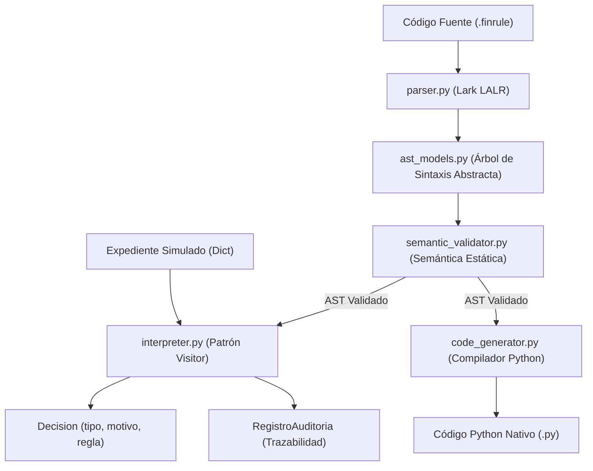

# FinRule DSL - Lenguaje de Dominio Específico para Reglas de Crédito y Fraude

> **Proyecto Integrador**  
> **Institución:** Universidad Científica del Sur  
> **Carrera:** Ingeniería de Software  
> **Curso:** Lenguaje de Dominio Específico (2026)  
> **Docente:** Mg. Ing. Carlos Sánchez Villarreal  
> **Estudiantes:** Joau Emmanuel Tejada Avellaneda, Valverde Virhuez Gandhi Bruce  

[](#pruebas-automatizadas)
[](https://www.python.org/)
[](LICENSE)

---

## 1. Descripción del Proyecto y Dominio

**FinRule DSL** es un lenguaje de dominio específico textual, externo y declarativo diseñado para permitir a analistas de riesgo crediticio y especialistas antifraude especificar, versionar y auditar políticas de evaluación crediticia de consumo sin depender del ciclo de despliegue de desarrollo de TI (*Fowler, 2010*).

### Problema que Resuelve
En las entidades financieras tradicionales, las reglas de riesgo suelen estar acopladas dentro del código de propósito general (GPL) de las aplicaciones bancarias. Modificar un umbral de mora o agregar un filtro antifraude requiere coordinar con desarrolladores, modificar código fuente, realizar pruebas de regresión y desplegar nuevas versiones. FinRule DSL desacopla la lógica de negocio en archivos de políticas declarativos (`.finrule`), garantizando:
- **Expresividad de Negocio:** Sintaxis orientada al vocabulario bancario en español.
- **Trazabilidad y Auditoría:** Identificadores únicos por regla, motivos explícitos y control de versiones formal (según principios de Basilea y directivas SBS).
- **Semántica Segura:** Tipado estático estricto, mitigación de fallos en tiempo de ejecución y política obligatoria de cobertura por defecto (`defecto`).

---

## 2. Arquitectura del Sistema (Capas Limpias)

El proyecto sigue una arquitectura en capas desacopladas donde cada módulo tiene una única responsabilidad:



### Módulos del Proyecto:

1. **`ast_models.py` (Árbol de Sintaxis Abstracta):**
   - Modela los conceptos del metamodelo utilizando `@dataclass` puras de Python.
   - Nodos principales: `Politica`, `Regla`, `Comparacion`, `Conjuncion`, `Disyuncion`, `Negacion`, `Accion`, `Defecto`, `Decision` y `RegistroAuditoria`.

2. **`parser.py` (Analizador Léxico y Sintáctico):**
   - Utiliza la librería **Lark** con algoritmo de parsing **LALR(1)**.
   - Procesa la gramática EBNF del lenguaje y utiliza un `Transformer` fuertemente tipado para instanciar el AST.

3. **`semantic_validator.py` (Semántica Estática):**
   - Valida la compatibilidad de tipos (e.g., bloquea comparaciones entre booleanos y números o textos).
   - Verifica que cada atributo exista previamente en el *Diccionario de Atributos del Expediente Simulado*.
   - Garantiza la unicidad de nombres de reglas y valida motivos no vacíos.

4. **`interpreter.py` (Motor de Ejecución Dinámica):**
   - Aplica el patrón de diseño **Visitor** (`ASTVisitor`) desacoplando la lógica de evaluación de la estructura de datos.
   - Ordena las reglas dinámicamente de mayor a menor prioridad (`prioridad`).
   - Aplica **cortocircuito lógico** (*short-circuit evaluation*) en conjunciones (`y`) y disyunciones (`o`).
   - Retorna la recomendación de la primera regla satisfecha (*first-match policy*) o dispara la cláusula por defecto.

5. **`code_generator.py` (Compilador a Python Nativo):**
   - Implementa la Sección VI.B de la especificación: traduce el AST a funciones de Python con cadenas `if / elif / else` para entornos de alta concurrencia.

6. **`test_finrule.py` (Suite de Pruebas Automatizadas):**
   - Suite con **pytest** que cubre los 5 casos de uso de la especificación (C1 a C5), la cláusula por defecto, validaciones semánticas de error y cortocircuito lógico.

---

## 3. Gramática Formal EBNF

```ebnf
Programa       = "politica", Cadena, "version", Cadena,
                 "{", Regla, { Regla }, Defecto, "}" ;
Regla          = "regla", Cadena, "prioridad", Entero,
                 "cuando", Expresion, "entonces", Accion, ";" ;
Defecto        = "defecto", Accion, ";" ;
Expresion      = Disyuncion ;
Disyuncion     = Conjuncion, { "o", Conjuncion } ;
Conjuncion     = Negacion, { "y", Negacion } ;
Negacion       = [ "no" ], Primaria ;
Primaria       = Comparacion | "(", Expresion, ")" ;
Comparacion    = Identificador, Operador, Literal ;
Operador       = "==" | "!=" | ">=" | "<=" | ">" | "<" ;
Accion         = ("aprobar" | "rechazar" | "revision"), "(", Cadena, ")" ;
Literal        = Decimal | Entero | Booleano | Cadena ;
Booleano       = "verdadero" | "falso" ;
Identificador  = Letra, { Letra | Digito | "_" } ;
Entero         = Digito, { Digito } ;
Decimal        = Entero, ".", Entero ;
Cadena         = '"', { CaracterPermitido }, '"' ;
```

---

## 4. Diccionario de Atributos del Expediente Simulado

| Campo DSL | Tipo | Restricciones / Rango | Descripción |
| :--- | :--- | :--- | :--- |
| `alerta_fraude` | booleano | `verdadero`, `falso` | Señal externa de posible anomalía. |
| `identidad_verificada` | booleano | `verdadero`, `falso` | Resultado del sistema biométrico / validación de identidad. |
| `documentos_verificados`| booleano | `verdadero`, `falso` | Estado agregado de revisión de sustentos. |
| `dias_mora_vigente` | entero | $\ge 0$ | Días de atraso en deudas vigentes. |
| `ratio_cuota_ingreso` | decimal | $\ge 0.0$ | Carga financiera mensual sobre ingresos verificados. |
| `puntaje_riesgo` | entero | $0 \le x \le 1000$ | Score interno simulado de comportamiento crediticio. |
| `monto_solicitado` | decimal | $> 0.0$ | Monto solicitado para el crédito. |
| `producto` | texto | string | Tipo de crédito (ej. `"consumo"`). |

---

## 5. Política de Ejemplo (`credito_consumo.finrule`)

```finrule
politica "CREDITO_CONSUMO" version "1.0" {
  regla "R01_FRAUDE" prioridad 100
    cuando alerta_fraude == verdadero
    entonces revision("ALERTA_OPERACION_SOSPECHOSA");
 
  regla "R02_IDENTIDAD" prioridad 90
    cuando identidad_verificada == falso
    entonces revision("IDENTIDAD_PENDIENTE");
 
  regla "R03_DOCUMENTOS" prioridad 85
    cuando documentos_verificados == falso
    entonces revision("DOCUMENTACION_INCOMPLETA");
 
  regla "R04_MORA_ALTA" prioridad 80
    cuando dias_mora_vigente >= 30
    entonces rechazar("MORA_ELEVADA");
 
  regla "R05_MORA_LEVE" prioridad 75
    cuando dias_mora_vigente > 0
    entonces revision("MORA_PENDIENTE");
 
  regla "R06_ENDEUDAMIENTO" prioridad 70
    cuando ratio_cuota_ingreso > 0.40
    entonces revision("CAPACIDAD_DE_PAGO");
 
  regla "R07_PUNTAJE" prioridad 60
    cuando puntaje_riesgo < 600
    entonces revision("PUNTAJE_PARA_REVISION");
 
  regla "R08_PREAPROBACION" prioridad 10
    cuando alerta_fraude == falso y
           identidad_verificada == verdadero y
           documentos_verificados == verdadero y
           dias_mora_vigente == 0 y
           ratio_cuota_ingreso <= 0.40 y
           puntaje_riesgo >= 600
    entonces aprobar("ELEGIBLE_PRELIMINAR");
 
  defecto revision("CASO_NO_CLASIFICADO");
}
```

---

## 6. Escenarios de Prueba de Concepto (Casos de Uso C1 a C5)

| Caso | Expediente Simulado | Expectativa de Diseño | Decisión Emitida por FinRule | Regla Determinante |
| :--- | :--- | :--- | :--- | :--- |
| **C1** | `alerta_fraude`: Falso, `identidad`: True, `docs`: True, `mora`: 0, `ratio`: 0.28, `score`: 710 | Preaprobación técnica | **`aprobar("ELEGIBLE_PRELIMINAR")`** | `R08_PREAPROBACION` |
| **C2** | `alerta_fraude`: Verdadero (restantes indiferentes) | Revisión humana | **`revision("ALERTA_OPERACION_SOSPECHOSA")`** | `R01_FRAUDE` |
| **C3** | `alerta_fraude`: Falso, validaciones OK, `mora`: 45 | Rechazo por riesgo | **`rechazar("MORA_ELEVADA")`** | `R04_MORA_ALTA` |
| **C4** | `alerta_fraude`: Falso, validaciones OK, `mora`: 0, `ratio`: 0.52, `score`: 730 | Revisión humana | **`revision("CAPACIDAD_DE_PAGO")`** | `R06_ENDEUDAMIENTO` |
| **C5** | `alerta_fraude`: Falso, `identidad`: True, `documentos`: Falso | Revisión humana | **`revision("DOCUMENTACION_INCOMPLETA")`** | `R03_DOCUMENTOS` |

---

## 7. Instalación y Ejecución

### Requisitos Previos
- Python 3.10 o superior instalado.
- Git instalado.

### Instalación de Dependencias
```bash
# Clonar el repositorio
git clone <URL_DE_TU_REPOSITORIO>
cd finrule-dsl

# Crear y activar entorno virtual (opcional pero recomendado)
python -m venv venv
# En Windows:
venv\Scripts\activate
# En Linux/macOS:
source venv/bin/activate

# Instalar dependencias
pip install -r requirements.txt
```

### Ejecución de Pruebas Automatizadas (pytest)
```bash
pytest test_finrule.py -v
```
Salida esperada:
```text
test_finrule.py::test_escenario_c1_perfil_elegible PASSED                [  5%]
test_finrule.py::test_escenario_c2_alerta_fraude PASSED                  [ 11%]
test_finrule.py::test_escenario_c3_mora_elevada PASSED                   [ 17%]
test_finrule.py::test_escenario_c4_carga_financiera_alta PASSED          [ 23%]
test_finrule.py::test_escenario_c5_documentacion_pendiente PASSED        [ 29%]
test_finrule.py::test_clausula_defecto_ejecutada PASSED                  [ 35%]
test_finrule.py::test_registro_auditoria_completo PASSED                 [ 41%]
test_finrule.py::test_semantica_bloquea_atributo_no_declarado PASSED     [ 47%]
test_finrule.py::test_semantica_bloquea_booleano_comparado_con_entero PASSED [ 52%]
test_finrule.py::test_semantica_bloquea_operador_relacional_en_booleano PASSED [ 58%]
test_finrule.py::test_semantica_bloquea_comparacion_entero_con_texto PASSED [ 64%]
test_finrule.py::test_semantica_bloquea_reglas_con_nombres_duplicados PASSED [ 70%]
test_finrule.py::test_cortocircuito_logico_conjuncion PASSED             [ 76%]
test_finrule.py::test_cortocircuito_logico_disyuncion PASSED             [ 82%]
test_finrule.py::test_ordenamiento_dinamico_por_prioridad PASSED         [ 88%]
test_finrule.py::test_sintaxis_incorrecta_falta_entonces PASSED          [ 94%]
test_finrule.py::test_generador_codigo_compilado PASSED                  [100%]

============================= 17 passed in 0.43s ==============================
```

### Ejecución de la Demostración Interactiva
```bash
python main.py
```

---

## 8. Pasos para Subir este Proyecto a GitHub

Este directorio ya se encuentra inicializado con Git. Para conectarlo a tu cuenta de GitHub, sigue estos pasos:

1. Crea un nuevo repositorio en [GitHub](https://github.com/new) con el nombre `finrule-dsl` (déjalo público o privado, sin marcar "Add a README file" ya que este ya existe).
2. En tu terminal, dentro de esta carpeta, ejecuta:

```bash
# Agregar la URL remota de tu repositorio creado en GitHub
git remote add origin https://github.com/<TU_USUARIO>/finrule-dsl.git

# Renombrar la rama a main (si no lo está ya)
git branch -M main

# Subir todos los commits
git push -u origin main
```

---

## 9. Referencias Bibliográficas

- **Fowler, M.** (2010). *Domain-Specific Languages*. Addison-Wesley Professional.
- **Basel Committee on Banking Supervision.** (2025). *Principles for the management of credit risk*. Bank for International Settlements.
- **Superintendencia de Banca, Seguros y AFP (SBS).** (2011). *Resolución SBS N.º 3780-2011: Reglamento de Gestión de Riesgo de Crédito (texto actualizado)*.
- **Lark-Parser Documentation.** (2024). *Lark: A parsing toolkit for Python*. https://lark-parser.readthedocs.io/
